# EconLean — Human-Readable Math Companion

A readable mathematical guide to every definition, lemma, and theorem formalized in `EconLean` (Lean 4 + Mathlib), following Mas-Colell, Whinston & Green (*Microeconomic Theory*, MWG) and Kreps.

Every result below mirrors the exact hypotheses and proof structure of the verified Lean code. For the LaTeX / `leanblueprint` version (PDF + interactive dependency graph), see [`blueprint/src/content.tex`](../blueprint/src/content.tex).

---

## Theorem Dependency Graph

```mermaid
flowchart TD
  subgraph S1["1. Preferences (Basic.lean)"]
    P["P (strict ≻) & I (indiff ∼)"]
    Rat["Rational (complete + trans)"]
    Refl["refl"]
    Piff["P_iff_not"]
    Pprops["P_irrefl / P_trans / mixed"]
    Ieq["I_equivalence"]
    Tri["trichotomy"]
    Rat --> Refl --> Ieq
    Rat --> Piff
    P --> Piff
    P --> Pprops
    Rat --> Tri
  end

  subgraph S2["2. Utility (Utility.lean)"]
    Rep["Represents u R"]
    RepRat["Represents.rational"]
    RepP["Represents.P_iff"]
    Ord["comp_strictMono"]
    FinU["exists_utility_of_finite"]
    RatIff["rational_iff_exists_utility"]
    Rep --> RepRat
    Rep --> RepP
    Rep --> Ord
    Rat --> FinU --> RatIff
    Refl --> FinU
    RepRat --> RatIff
  end

  subgraph S3["3. Budget Sets (Budget.lean)"]
    Cost["cost p · x & bilinearity"]
    Bud["budgetSet B(p, w)"]
    Bsmul["budgetSet_smul"]
    Bconv["convex_budgetSet"]
    Bclosed["isClosed_budgetSet"]
    Bcomp["isCompact_budgetSet"]
    Cost --> Bud
    Bud --> Bsmul
    Bud --> Bconv
    Bud --> Bclosed --> Bcomp
  end

  subgraph S4["4. Walrasian Demand (Demand.lean)"]
    Dem["demand x(p, w)"]
    Dsmul["demand_smul"]
    LNS["LocallyNonsatiated"]
    Mono["StronglyMonotone ⇒ LNS"]
    Better["exists_better_affordable"]
    Walras["walras_law"]
    Dne["demand_nonempty"]
    Dconv["convex_demand"]
    Bud --> Dem
    Bsmul --> Dsmul
    LNS --> Better --> Walras
    Mono --> LNS
    Bcomp --> Dne
    Bconv --> Dconv
  end

  subgraph S5["5. Duality (Duality.lean)"]
    DualDefs["v(p,w), e(p,ū), h(p,ū)"]
    Scale["exists_cheaper_above"]
    U2E["demand_subset_hicksian"]
    EV["e(p, v(p,w)) = w"]
    NoEx["utility_eq_of_mem_hicksian"]
    E2U["hicksian_subset_demand"]
    Hne["hicksian_nonempty"]
    VE["v(p, e(p,ū)) = ū"]
    Conc["expenditure_concave & homog."]
    Better --> U2E --> EV
    Walras --> EV
    Dne --> EV
    Scale --> NoEx --> VE
    Scale --> E2U --> VE
    Bcomp --> Hne --> VE
    DualDefs --> Conc
  end

  subgraph S6["6. Revealed Preference"]
    WARP["warp_of_rational"]
    CLD["compensated_law_of_demand"]
    Dem --> WARP --> CLD
  end

  subgraph S7["7. Envelope Results (Envelope.lean)"]
    Shep["shephard / shephard_partial"]
    Huniq["hicksian_unique"]
    Roy["roy / roy_partial"]
    Slut["slutsky"]
    DualDefs --> Shep --> Huniq
    Walras --> Roy
    Dne --> Roy
    Shep -. "supplies E'δ = δ·H(p)" .-> Slut
  end
```

---

## 1. Preference Relations and Rationality
*Source: [`EconLean/Preferences/Basic.lean`](../EconLean/Preferences/Basic.lean) — MWG §1.B (Prop. 1.B.1)*

Let $X$ be a set of alternatives and $R \subseteq X \times X$ a binary relation written $x \succsim y$ ("$x$ is at least as good as $y$").

- **Definition (`Econ.P`, `Econ.I`):**
  - *Strict preference:* $x \succ y \iff x \succsim y \land \neg(y \succsim x)$.
  - *Indifference:* $x \sim y \iff x \succsim y \land y \succsim x$.
- **Definition (`Econ.Rational`):** $R$ is **rational** if it is:
  1. **Complete:** $\forall x, y \in X,\; x \succsim y \lor y \succsim x$.
  2. **Transitive:** $\forall x, y, z \in X,\; x \succsim y \land y \succsim z \implies x \succsim z$.

### Key Results
1. **Reflexivity (`Econ.Rational.refl`):** If $R$ is rational, then $x \succsim x$ for all $x$.
   *Proof:* Apply completeness to $(x, x)$: $x \succsim x \lor x \succsim x \implies x \succsim x$.
2. **Strict preference via negation (`Econ.Rational.P_iff_not`):** Under rationality, $x \succ y \iff \neg(y \succsim x)$.
   *Proof:* $(\Rightarrow)$ is by definition. $(\Leftarrow)$ By completeness, $x \succsim y \lor y \succsim x$; excluding $y \succsim x$ yields $x \succsim y$, hence $x \succ y$.
3. **Strict preference properties (`Econ.P_irrefl`, `Econ.P_trans`, `Econ.P_of_P_of_R`, `Econ.P_of_R_of_P`):**
   - $\neg(x \succ x)$ holds unconditionally (no axioms on $R$).
   - If $R$ is transitive (completeness not needed), then $\succ$ is transitive and satisfies mixed transitivity ($x \succ y \succsim z \implies x \succ z$ and $x \succsim y \succ z \implies x \succ z$).
   *Proof:* For $x \succ y \succsim z$, transitivity gives $x \succsim z$; if $z \succsim x$ then $y \succsim z \succsim x$ gives $y \succsim x$, contradicting $x \succ y$.
4. **Indifference is an equivalence relation (`Econ.Rational.I_equivalence`)** and **$R$ is a preorder (`Econ.Rational.isPreorder`)**.
5. **Trichotomy (`Econ.Rational.trichotomy`):** Under rationality, for any $x, y$, at least one (and by definition exactly one) of $x \succ y$, $x \sim y$, or $y \succ x$ holds.

---

## 2. Utility Representations
*Source: [`EconLean/Preferences/Utility.lean`](../EconLean/Preferences/Utility.lean) — MWG §1.B (Prop. 1.B.2), §3.C*

- **Definition (`Econ.Represents`):** A function $u : X \to \mathbb{R}$ **represents** $R$ if
  $$\forall x, y \in X,\quad x \succsim y \iff u(y) \le u(x).$$
- **Definition (`Econ.prefOf`, `Econ.represents_prefOf`):** Any $u : X \to \mathbb{R}$ induces $\succsim_u$ via $x \succsim_u y \iff u(y) \le u(x)$, tautologically represented by $u$.

### Key Results
1. **Representable $\implies$ Rational (`Econ.Represents.rational`, MWG Prop. 1.B.2):**
   *Proof:* Pull back totality and transitivity of $\le$ on $\mathbb{R}$ along $u$.
2. **Strict preference (`Econ.Represents.P_iff`):** $x \succ y \iff u(y) < u(x)$.
3. **Ordinal invariance (`Econ.Represents.comp_strictMono`):** If $u$ represents $R$ and $f : \mathbb{R} \to \mathbb{R}$ is strictly increasing, then $f \circ u$ also represents $R$.
   *Proof:* Strict monotonicity gives $f(u(y)) \le f(u(x)) \iff u(y) \le u(x) \iff x \succsim y$.
4. **Existence on finite sets (`Econ.exists_utility_of_finite`, `Econ.rational_iff_exists_utility`):** On a finite set $X$, $R$ is rational if and only if it has a utility representation.
   *Proof:* Define the lower contour set $L(x) = \{y \in X \mid x \succsim y\}$ (`Econ.lowerContour`) and counting utility $u(x) = |L(x)|$ (`Econ.countingUtility`).
   - If $x \succsim y$, transitivity gives $L(y) \subseteq L(x)$ (`Econ.lowerContour_subset`), so $u(y) \le u(x)$.
   - Conversely, if $\neg(x \succsim y)$, completeness gives $y \succsim x$ so $L(x) \subseteq L(y)$, while $y \in L(y)$ (by reflexivity) and $y \notin L(x)$. Thus $L(x) \subsetneq L(y)$, hence $u(x) < u(y)$.

---

## 3. Commodity Space, Prices, and Budget Sets
*Source: [`EconLean/Consumer/Budget.lean`](../EconLean/Consumer/Budget.lean) — MWG §2.B–2.D*

Let $\iota$ be a finite set of goods. Bundles are vectors $x \in \mathbb{R}^\iota$ with the pointwise order and sup-norm metric $d(x, y) = \max_i |x_i - y_i|$.

- **Cost (`Econ.cost`):** $p \cdot x = \sum_{i \in \iota} p_i x_i$. It is bilinear, continuous in $x$, nonnegative for $p, x \ge 0$, and satisfies $p \gg 0 \land x \ge 0 \land p \cdot x = 0 \implies x = 0$ (`Econ.eq_zero_of_cost_eq_zero`).
- **Walrasian budget set (`Econ.budgetSet`):**
  $$B(p, w) = \{x \in \mathbb{R}^\iota \mid x \ge 0 \land p \cdot x \le w\}.$$

### Key Results
1. **Scale invariance (`Econ.budgetSet_smul`):** For $\alpha > 0$, $B(\alpha p, \alpha w) = B(p, w)$.
2. **Nonemptiness (`Econ.zero_mem_budgetSet`):** If $w \ge 0$, then $0 \in B(p, w)$.
3. **Convexity (`Econ.convex_budgetSet`):** $B(p, w) = \{x \ge 0\} \cap \{x \mid p \cdot x \le w\}$ is the intersection of two convex sets.
4. **Closedness (`Econ.isClosed_budgetSet`):** Intersection of two sets defined by non-strict inequalities between continuous functions.
5. **Compactness (`Econ.isCompact_budgetSet`):** If $p \gg 0$, every $x \in B(p, w)$ satisfies $0 \le x_i \le w / p_i$ (`Econ.le_div_of_mem_budgetSet`), so $B(p, w)$ is a closed subset of the compact box $\prod_i [0, w/p_i]$, hence compact.

---

## 4. Walrasian Demand, Walras' Law, and Existence
*Source: [`EconLean/Consumer/Demand.lean`](../EconLean/Consumer/Demand.lean) — MWG §2.D–2.E, §3.B, §3.D*

- **Walrasian demand (`Econ.demand`):**
  $$x(p, w) = \{x \in B(p, w) \mid \forall y \in B(p, w),\; x \succsim y\}.$$
- **Local nonsatiation (`Econ.LocallyNonsatiated`):** $\forall x \ge 0,\; \forall \varepsilon > 0,\; \exists y \ge 0,\; d(y, x) < \varepsilon \land y \succ x$.
- **Strong monotonicity (`Econ.StronglyMonotone`):** $0 \le x \le y \land x \ne y \implies y \succ x$.
- **Convex preferences (`Econ.ConvexPref`):** For every $x$, $\{y \mid y \succsim x\}$ is convex.

### Key Results
1. **Homogeneity of degree 0 (`Econ.demand_smul`, MWG Prop. 3.D.2(i)):** $x(\alpha p, \alpha w) = x(p, w)$ for $\alpha > 0$, directly from $B(\alpha p, \alpha w) = B(p, w)$.
2. **Walras' law (`Econ.walras_law`, MWG Prop. 3.D.2(ii)):** Under local nonsatiation, $x \in x(p, w) \implies p \cdot x = w$.
   *Proof:* If $p \cdot x < w$, continuity of cost yields a ball around $x$ where $p \cdot z < w$; local nonsatiation finds $z \ge 0$ in that ball with $z \succ x$ (`Econ.exists_better_affordable`), contradicting optimality of $x$.
3. **Strong monotonicity $\implies$ Local nonsatiation (`Econ.StronglyMonotone.locallyNonsatiated`):** When $\iota$ is nonempty, perturb $x$ to $y = x + (\varepsilon/2)\mathbf{1}$.
4. **Existence (`Econ.demand_nonempty`, MWG Prop. 3.D.1):** If $u$ is continuous, $p \gg 0$, and $w \ge 0$, then $x(\succsim_u; p, w) \ne \emptyset$.
   *Proof:* $B(p, w)$ is compact and nonempty ($0 \in B(p, w)$), so $u$ attains its maximum on $B(p, w)$ by Weierstrass's extreme value theorem.
5. **Convexity (`Econ.convex_demand`, MWG Prop. 3.D.2(iii)):** Rational + convex preferences imply $x(p, w)$ is convex.
   *Proof:* For $x, y \in x(p, w)$ and $a, b \ge 0$ with $a + b = 1$, $ax + by \in B(p, w)$ by convexity of $B(p, w)$, and both $x, y \succsim x$ imply $ax + by \succsim x \succsim z$ for all $z \in B(p, w)$.

---

## 5. Indirect Utility, Expenditure Minimization, and Duality
*Source: [`EconLean/Consumer/Duality.lean`](../EconLean/Consumer/Duality.lean) — MWG §3.D–3.E*

Fix $u : \mathbb{R}^\iota \to \mathbb{R}$.
- **Indirect utility (`Econ.indirectUtility`):** $v(p, w) = \sup \{u(x) \mid x \in B(p, w)\}$.
- **Upper contour set (`Econ.upperSet`):** $U(u, \bar{u}) = \{x \ge 0 \mid u(x) \ge \bar{u}\}$.
- **Expenditure function (`Econ.expenditure`):** $e(p, \bar{u}) = \inf \{p \cdot x \mid x \in U(u, \bar{u})\}$.
- **Hicksian demand (`Econ.hicksian`):** $h(p, \bar{u}) = \{x \in U(u, \bar{u}) \mid \forall y \in U(u, \bar{u}),\; p \cdot x \le p \cdot y\}$.

When optimizers exist, $v(p, w) = u(x)$ (`Econ.indirectUtility_eq`) and $e(p, \bar{u}) = p \cdot x$ (`Econ.expenditure_eq`).

### Key Results
1. **Scaling-down lemma (`Econ.exists_cheaper_above`):** If $u$ is continuous, $p \gg 0$, $u(0) \le \bar{u} < u(y)$, and $y \ge 0$, then there exists $z \ge 0$ with $u(z) > \bar{u}$ and $p \cdot z < p \cdot y$.
   *Proof:* $p \cdot y > 0$ (else $y = 0$, contradicting $u(0) \le \bar{u} < u(y)$). By continuity of $t \mapsto u(ty)$ at $t = 1$, pick $t \in (0, 1)$ with $u(ty) > \bar{u}$ and set $z = ty$.
2. **Duality Part 1 — UMP $\implies$ EMP (`Econ.demand_subset_hicksian`, MWG Prop. 3.E.3(i)):** Under local nonsatiation, $x \in x(\succsim_u; p, w) \implies x \in h(p, u(x))$.
   *Proof:* If some $y \in U(u, u(x))$ had $p \cdot y < p \cdot x \le w$, local nonsatiation would yield an affordable $z \in B(p, w)$ with $u(z) > u(y) \ge u(x)$, contradicting optimality of $x$.
3. **Duality identity 1 (`Econ.expenditure_indirectUtility`):** For continuous, locally nonsatiated $u$, $p \gg 0$, and $w \ge 0$:
   $$e(p, v(p, w)) = w.$$
   *Proof:* Pick $x \in x(\succsim_u; p, w)$; by Part 1 and Walras' law, $e(p, v(p, w)) = e(p, u(x)) = p \cdot x = w$.
4. **No excess utility (`Econ.utility_eq_of_mem_hicksian`):** For continuous $u$, $p \gg 0$, $u(0) \le \bar{u}$, and $x \in h(p, \bar{u})$, we have $u(x) = \bar{u}$.
   *Proof:* If $u(x) > \bar{u}$, scaling down gives a strictly cheaper bundle above $\bar{u}$.
5. **Duality Part 2 — EMP $\implies$ UMP (`Econ.hicksian_subset_demand`, MWG Prop. 3.E.3(ii)):** For continuous $u$, $p \gg 0$, $u(0) \le \bar{u}$, and $x \in h(p, \bar{u})$, we have $x \in x(\succsim_u; p, p \cdot x)$.
   *Proof:* If some $y \in B(p, p \cdot x)$ had $u(y) > u(x) \ge \bar{u}$, scaling $y$ down gives $z \in U(u, \bar{u})$ with $p \cdot z < p \cdot y \le p \cdot x$, contradicting $x \in h(p, \bar{u})$.
6. **Existence of Hicksian demand (`Econ.hicksian_nonempty`):** If $u$ is continuous, $p \gg 0$, and $x_0 \in U(u, \bar{u})$, then $h(p, \bar{u}) \ne \emptyset$.
   *Proof:* Minimize the continuous function $p \cdot x$ over the compact nonempty set $K = B(p, p \cdot x_0) \cap \{x \mid u(x) \ge \bar{u}\}$.
7. **Duality identity 2 (`Econ.indirectUtility_expenditure`):** For continuous $u$, $p \gg 0$, $u(0) \le \bar{u}$, and reachable $\bar{u}$:
   $$v(p, e(p, \bar{u})) = \bar{u}.$$
8. **Properties of $v, h, e$ (`indirectUtility_smul`, `indirectUtility_mono`, `hicksian_smul`, `expenditure_smul`, `expenditure_concave`):**
   - $v$ is homogeneous of degree $0$ in $(p, w)$ and nondecreasing in $w$.
   - $h$ is homogeneous of degree $0$ in $p$; $e$ is homogeneous of degree $1$ in $p$.
   - $e$ is **concave in prices:** for $a, b \ge 0$, $a e(p, \bar{u}) + b e(q, \bar{u}) \le e(ap + bq, \bar{u})$, because the optimizer $x_m \in h(ap + bq, \bar{u})$ is feasible (though not necessarily optimal) at both $p$ and $q$.

---

## 6. Revealed Preference: WARP and the Compensated Law of Demand
*Source: [`EconLean/Consumer/RevealedPreference.lean`](../EconLean/Consumer/RevealedPreference.lean) — MWG §2.F, §3.J*

- **WARP (`Econ.WARP`, MWG Def. 2.F.1):** A demand function $x(p, w)$ satisfies WARP if for all $p, p' \gg 0$ and $w, w' \ge 0$,
  $$p \cdot x(p', w') \le w \;\land\; x(p', w') \ne x(p, w) \implies p' \cdot x(p, w) > w'.$$

### Key Results
1. **Unique rational choice satisfies WARP (`Econ.warp_of_unique_demand`, `Econ.warp_of_rational`):**
   *Proof:* If $p' \cdot x \le w'$, then $x \succsim x'$ (since $x'$ was affordable at $(p, w)$) and $x' \succsim y$ for all $y \in B(p', w')$, so by transitivity $x \in x(p', w') = \{x'\}$, contradicting $x' \ne x$.
2. **Compensated law of demand (`Econ.compensated_law_of_demand`, `Econ.compensated_law_of_demand_strict`, MWG Prop. 2.F.1):**
   If $p \cdot x = w$, $p' \cdot x' = w'$, $w' = p' \cdot x$ (Slutsky compensation), and WARP holds, then
   $$(p' - p) \cdot (x' - x) \le 0,$$
   strictly if $x \ne x'$.
   *Proof:* Expanding gives $(p' \cdot x' - p' \cdot x) - (p \cdot x' - p \cdot x) = (w' - w') - (p \cdot x' - w) = w - p \cdot x'$, which is $0$ if $x = x'$ and strictly negative by WARP if $x \ne x'$.

---

## 7. Envelope Results: Shephard's Lemma, Roy's Identity, and the Slutsky Equation
*Source: [`EconLean/Consumer/Envelope.lean`](../EconLean/Consumer/Envelope.lean) — MWG §3.G (Props. 3.G.1, 3.G.3, 3.G.4)*

All derivatives are Fréchet derivatives; partial derivatives are obtained by evaluating along basis vectors $e_j$.

### Key Results
1. **Shephard's lemma (`Econ.shephard`, `Econ.shephard_partial`, MWG Prop. 3.G.1):**
   If $p \gg 0$, $h \in h(p, \bar{u})$, and $q \mapsto e(q, \bar{u})$ has Fréchet derivative $E'$ at $p$, then
   $$E'(\delta) = \delta \cdot h \qquad \text{and} \qquad \frac{\partial e}{\partial p_j}(p, \bar{u}) = h_j.$$
   *Proof:* $g(q) = q \cdot h - e(q, \bar{u}) \ge 0$ for $q \gg 0$ near $p$ (since $h \in U(u, \bar{u})$), with $g(p) = 0$. Thus $g$ has a local minimum at $p$; by Fermat's theorem, $Dg(p) = (\delta \mapsto \delta \cdot h) - E' = 0$.
2. **Uniqueness of Hicksian demand (`Econ.hicksian_unique`):** If $e(\cdot, \bar{u})$ is differentiable at $p \gg 0$, then $h(p, \bar{u})$ is a singleton (every $h \in h(p, \bar{u})$ equals $\nabla_p e(p, \bar{u})$).
3. **Roy's identity (`Econ.roy`, `Econ.roy_partial`, MWG Prop. 3.G.4):**
   For continuous, locally nonsatiated $u$, $p \gg 0$, $x \in x(\succsim_u; p, w)$, and Fréchet derivative $V'$ of $v$ at $(p, w)$:
   $$V'(\delta, \delta \cdot x) = 0 \qquad \Longrightarrow \qquad x_j = -\frac{\partial v / \partial p_j}{\partial v / \partial w} \quad \left(\text{when } \frac{\partial v}{\partial w} \ne 0\right).$$
   *Proof:* By Walras' law $p \cdot x = w$, so $\varphi(q) = v(q, q \cdot x)$ satisfies $\varphi(q) \ge u(x) = \varphi(p)$ near $p$ (since $x \in B(q, q \cdot x)$). Fermat's theorem + chain rule give $D\varphi(p)(\delta) = V'(\delta, \delta \cdot x) = 0$. Evaluate at $\delta = e_j$ and split $(e_j, x_j) = (e_j, 0) + x_j(0, 1)$.
4. **Slutsky equation (`Econ.slutsky`, MWG Prop. 3.G.3):**
   If $H(q) = X(q, E(q))$ near $p$, all three are differentiable at $p$ (and $(p, E(p))$), and $E'(\delta) = \delta \cdot H(p)$ (Shephard's lemma), then
   $$H'(\delta) = X'(\delta, 0) + (\delta \cdot H(p))\, X'(0, 1),$$
   or in coordinates ($\delta = e_j$),
   $$\frac{\partial h_i}{\partial p_j} = \frac{\partial x_i}{\partial p_j} + h_j \frac{\partial x_i}{\partial w}.$$
   *Proof:* Apply the chain rule to $H(q) = X(q, E(q))$, substitute $E'(\delta) = \delta \cdot H(p)$, and expand $(\delta, \delta \cdot H(p)) = (\delta, 0) + (\delta \cdot H(p))(0, 1)$ by linearity of $X'$.
